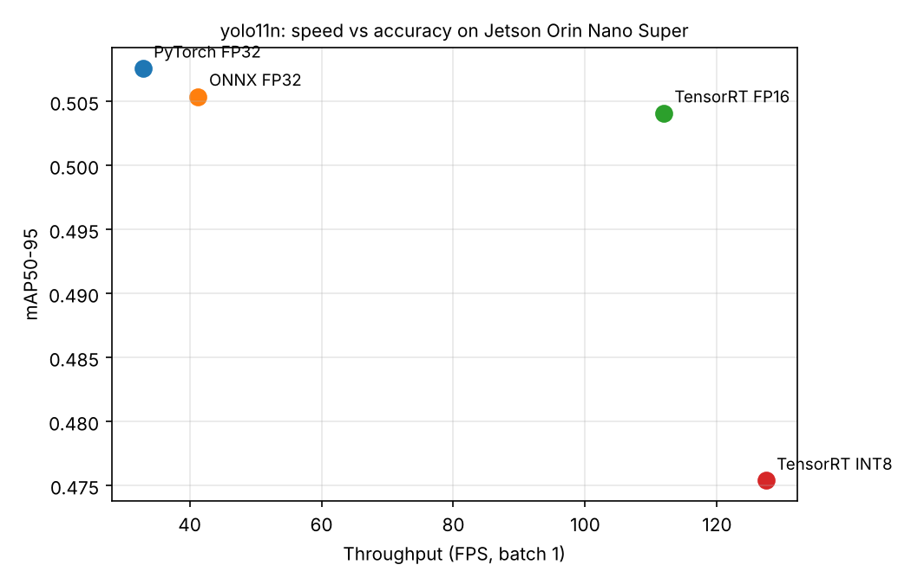

# Jetson YOLO Optimization Benchmark

Case study #1 for the QSInfomatic edge-AI portfolio: take a stock YOLO11 model and show the
speed-up from PyTorch → ONNX → TensorRT FP16 → TensorRT INT8 on an NVIDIA Jetson, with the
accuracy cost of each step measured.

## Results (YOLO11n, 640×640, batch 1)



| Format | Latency (ms) | FPS | Speed-up | mAP50-95 | Δ mAP | Board power (W) | Energy / frame (mJ) |
|---|---|---|---|---|---|---|---|
| PyTorch FP32 | 30.4 | 32.9 | 1.0× | 0.508 | — | 8.8 | 267 |
| ONNX FP32 | 24.2 | 41.3 | 1.3× | 0.505 | −0.2 pts | 10.2 | 248 |
| **TensorRT FP16** | **8.9** | **111.9** | **3.4×** | **0.504** | **−0.4 pts** | 9.6 | 86 |
| TensorRT INT8 | 7.9 | 127.4 | 3.9× | 0.475 | −3.2 pts | 8.9 | 70 |

**Takeaways**
- **TensorRT FP16 is the sweet spot:** 3.4× faster than PyTorch with almost no accuracy loss (−0.4 mAP points).
- **INT8 is fastest** at 127 FPS and 3.8× less energy per frame, but costs 3.2 mAP points. Use it when
  speed or battery life matters more than the last bit of accuracy, or improve it with a larger
  calibration set.
- All of this runs at about 9 W of board power.

**Test setup:** NVIDIA Jetson Orin Nano Super dev kit, L4T R39.2.1, Ultralytics Jetson container.
Latency is the mean of 300 runs after 30 warm-up runs. Two full runs agreed within 2%.
mAP was measured on coco128 as a quick accuracy check; full COCO val2017 numbers will follow.
Board power is the average `VDD_IN` reading from `tegrastats` during the timing loop.
Raw data: [`results/results.csv`](results/results.csv).

## What it produces
- `results/results.csv` — latency, FPS, mAP50-95 and average board power for every format
- `results/report.md` — a ready-to-publish results table
- `results/fps_vs_accuracy.png` — the chart for your README / LinkedIn post

## Quick start (on the Jetson)
1. Do the one-time setup in [SETUP.md](SETUP.md).
2. Start the container from this folder:
   ```bash
   sudo docker run -it --rm --ipc=host --runtime=nvidia \
     -v "$PWD":/work -w /work \
     -v /usr/bin/tegrastats:/usr/bin/tegrastats \
     -v /proc/device-tree/model:/host/model:ro \
     -v /var/lib/nvpmodel:/var/lib/nvpmodel:ro \
     -v /etc/nvpmodel.conf:/etc/nvpmodel.conf:ro \
     ultralytics/ultralytics:latest-jetson-jetpack6
   ```
3. Inside the container:
   ```bash
   bash run_all.sh            # default model: yolo11n.pt
   bash run_all.sh yolo11s.pt # try a bigger model too
   ```
   The first run takes a while (TensorRT engine builds + INT8 calibration). Later runs reuse
   the engines in `models/`.

## Saving results to GitHub
Type `exit` to leave the container first. git does not work on this folder from inside
the container. Then, on the Jetson:
```bash
git add results/ && git commit -m "Add benchmark results" && git push
```

## Files
| File | Purpose |
|---|---|
| `scripts/export.py` | Exports ONNX, TensorRT FP16 and TensorRT INT8 versions of the model |
| `scripts/benchmark.py` | Measures latency/FPS, mAP and power for each format |
| `scripts/make_report.py` | Turns `results.csv` into a markdown table + chart |
| `run_all.sh` | Runs all three in order |

## Publishing checklist
- [ ] Note the board, JetPack version and power mode in the README (benchmark.py records them)
- [ ] Paste `results/report.md` into the README
- [ ] Add `results/fps_vs_accuracy.png`
- [ ] One-paragraph takeaway: "X× faster with <Y% mAP loss"
- [ ] Push to GitHub, then post on LinkedIn
